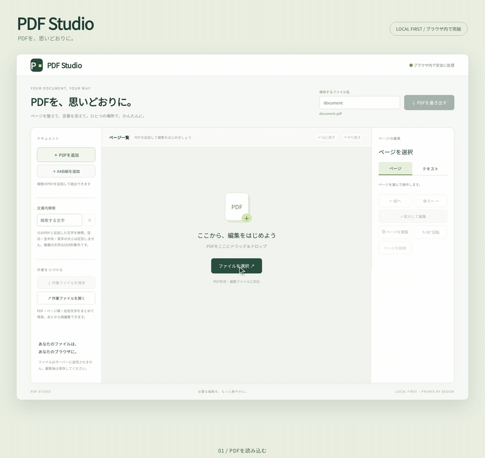

# PDF Studio

**PDFを、思いどおりに。**

ブラウザ内で完結する日本語PDFエディタ。ファイルはサーバーへ送信しません。



読み込む → 並べ替える → 日本語を添える → 書き出す。すべてブラウザの中で。

## 開発

Node.js 22以降で実行してください。

```sh
npm ci
npm run dev
```

```sh
npm test
npm run build
```

本番成果物は `dist/` に出力されます。静的ホスティングで利用できます。

## できること

- 複数PDFの読み込み・プレビュー・結合
- ドラッグまたはボタンによるページ並べ替え
- ページの複製・削除・90度回転
- A4白紙ページの追加（選択中のページの直後に挿入）
- 複数ページの選択・一括複製・一括回転・一括削除・選択ページだけの書き出し
- 75〜200%の拡大プレビューと、拡大画面でのテキスト配置
- ページをクリックして日本語テキストを追加（サイズ・色指定）
- 追加テキストの再編集・移動・個別削除
- 元に戻す・やり直す（最大30操作、キーボード操作にも対応）
- 編集したPDFのダウンロード
- 作業ファイル（`.pdfstudio`）の保存・復元

## 使い方

PDFを選択し、ページをクリックして選択します。右側の編集操作を使ってページを整えます。テキストは内容を入力して「配置モードにする」を押し、ページ上をクリックして追加します。追加した文字をクリックすると選択でき、内容・サイズ・色の更新、移動、個別削除ができます。「位置を変更」を押して同じページ上の移動先をクリックすると移動します。細かい位置を確認する場合は「拡大して編集」を使い、倍率を変更して配置できます。拡大画面はEscキーでも閉じられます。最後に「PDFを書き出す」で保存してください。

## ページをまとめて操作する

各ページ左上のチェックボックス、または「ページ番号で選択」で対象を選び、ページ一覧の上にある「複製」「回転」「削除」「選択ページを書き出す」を使います。「すべて選択」と「解除」にも対応します。番号指定は `1-3, 5` のように入力してEnterまたは「範囲を選択」を押します。全角数字・読点・波線にも対応し、重複はまとめられます。番号は現在の一覧順で、指定すると既存のチェックを置き換えます。入力が不正な場合は現在の選択を保持します。書き出すページ順は一覧の表示順です。複製は各元ページの直後に挿入され、複製後はコピーしたページがチェックされます。追加文字もコピーされ、それぞれ別々に再編集できます。一括複製・回転・削除も元に戻したり、やり直したりできます。ページをクリックして選ぶ通常の編集対象と、チェックした一括操作の対象は独立しています。

## キーボード操作

| 操作 | Windows / Linux | macOS |
| --- | --- | --- |
| 元に戻す | Ctrl + Z | Cmd + Z |
| やり直す | Ctrl + Shift + Z / Ctrl + Y | Cmd + Shift + Z |

通常画面・拡大画面のどちらでも使えます。入力欄では文字入力の取り消しを優先します。元に戻した後で新しい編集をすると、やり直し履歴はリセットされます。

## 作業を再開する

サイドバーの「作業ファイルを保存」で、元のPDF・ページ順・回転・追加テキストを含む `.pdfstudio` ファイルをダウンロードできます。次回「作業ファイルを開く」で読み込むと、文字も再編集できます。読み込みは現在の作業を置き換えますが、「元に戻す」で直前の作業へ戻れます。操作履歴自体はファイルに保存されません。PDFの書き出しは完成版の保存、作業ファイルは編集の再開に使います。いずれもサーバーへ送信しません。

## 制約

既存PDFの文字の直接編集、OCR、暗号化されたPDF、電子署名の保持には対応していません。編集状態は自動保存されません。「作業ファイルを保存」で保存し、「作業ファイルを開く」で復元できます。作業ファイルは元のPDFを含むため、PDFと同様に取り扱ってください。読み込みは100MBまで対応します。大きなPDFは端末のメモリに依存します。追加文字は日本語フォントNoto Sans JPで埋め込みます（ライセンスは `public/fonts/LICENSE`）。
