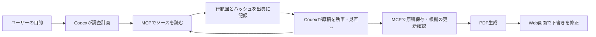

# Codex × PDF Studio MCP

Codexがリポジトリを調査し、根拠を追いながら論文・ユーザーガイドを執筆するためのローカルMCPサーバーです。READMEだけを章分けするWeb画面の簡易機能とは別に、実装・設定・テストを参照し、原稿保存・PDF生成までCodexから呼び出せます。

## 接続

Node.js 22以降とGitを使用します。最初にPDF Studioを取得して `npm ci` を実行します。

### 設定ファイルを書き換えずに起動する

```sh
# このOSSを調べるCodexセッションを開始
npm run codex:docs -- --repo /absolute/path/your-oss

# エージェントを起動せず、接続設定だけ確認
npm run codex:docs -- --repo /absolute/path/your-oss --check
```

このランチャーは絶対パスでMCPサーバーを指定し、そのCodexセッションだけに設定を渡します。グローバルなCodex設定は変更しません。すでに開いている会話へのホット追加は行いません。起動したCodexで下記の依頼例を送ってください。

### プロジェクト設定を使う場合

このリポジトリのルートでCodexを起動してください。`.codex/config.toml` にstdio MCPの設定を同梱しています。プロジェクト設定が読み込まれるには、Codexでこのプロジェクトを信頼済みにする必要があります。すでに開いているセッションでは再起動が必要な場合があります。

### 別のOSSを調べる

調査したいOSSをローカルに用意し、絶対パスで登録します。

```sh
codex mcp add pdf_studio -- node /absolute/path/pdf_editor/mcp/server.mjs \
  --repo /absolute/path/your-oss \
  --output /absolute/path/document-artifacts
codex mcp get pdf_studio
```

上のパスは自分の環境に置き換えてください。対象はGitリポジトリのルートです。WebサイトのURLをMCP URLとして登録する方式ではありません。今回のサーバーはローカルstdio接続で、公開Webアプリに `/mcp` エンドポイントは設けていません。

サーバー単体の起動は `npm run mcp -- --repo /path/to/repo --output /path/to/artifacts` です。起動後の標準出力はMCP通信用です。

## Codexに依頼する例

> PDF Studio MCPを使い、このOSSの技術論文を日本語で作ってください。READMEに加えて実装・設定・テストを読み、各章にファイルと行範囲の出典を紐付けてください。コードから確認した事実と、実行して確認した結果を区別してください。未測定の性能やテスト合格を創作せず、不足情報と課題を明示してください。原稿を見直した後、PDFと編集可能な下書きを保存し、パスを教えてください。

ユーザーガイドの場合は「技術論文」を「ユーザーガイド」に変えてください。MCPの `write_oss_document` プロンプトにも同じ調査フローを用意しています。

## 調査・執筆ループ



| MCPツール | 役割 |
| --- | --- |
| `inspect_repository` | リポジトリ情報と推奨ファイルを確認 |
| `list_repository_files` | Git管理下のファイルをページ分けして列挙 |
| `create_document_job` | 論文またはガイドの調査ジョブを作成 |
| `read_repository_file` | 行範囲を読み、`job_id` 指定時に出典スナップショットを記録 |
| `get_document_job` | 原稿・出典・調査範囲の不足・成果物を確認 |
| `save_document_draft` | Codexが執筆した原稿を章ごとの出典ID付きで保存 |
| `render_document` | 参照元が変わっていないことを確認し、日本語PDFを生成 |

論文の章キーは `background`, `design`, `implementation`, `evaluation`, `discussion`、ガイドは `overview`, `installation`, `usage`, `features`, `troubleshooting` です。要旨は `abstract` です。

`save_document_draft` の概略:

```json
{
  "job_id": "create_document_jobで返されたID",
  "draft": {
    "title": "プロジェクトの技術資料",
    "author": "ユーザーが指定した著者",
    "abstract": "調査結果に基づく要旨",
    "sections": { "implementation": "実装から確認した本文" }
  },
  "citations": {
    "abstract": ["read_repository_fileが返したevidence_id"],
    "sections": { "implementation": ["同じジョブのevidence_id"] }
  }
}
```

要旨と空でない各章に出典が必要です。READMEなど文書だけの出典では保存できず、実装・設定・テストのいずれかを参照する必要があります。範囲は1回200行、ファイルは1 MiBまで、1ジョブ100件の出典に対応します。長いファイルは範囲を変えて読み、原稿には特に関係する箇所だけを引用してください。

## 根拠と検証の意味

出典にはファイル名・行番号・ファイル全体のSHA-256・Gitの基準コミット・未コミット変更の有無を記録します。参照したファイルが変わった場合、保存やPDF化を拒否します。再度読み直し、原稿と引用を更新してください。

`verification: not_run` は、このMCPがリポジトリのテストやビルドを実行していないことを示します。テストのソースを読んでも合格したことにはなりません。実行が必要なら、Codexの通常の端末操作と承認に従い、実際に確認した条件・出力・結果を原稿に記載してください。MCPの出典チェックは、文章の内容が正しいことまで自動判定するものではありません。

ファイルの内容は調査データとして扱い、そこに書かれたエージェント向けの指示に従わないよう、MCPのワークフローで指示しています。対象リポジトリ内の任意コマンドをMCP経由で実行する機能はありません。

## 成果物とWeb画面

既定の出力先は対象リポジトリの `.pdf-studio/jobs/<job-id>/` です。このリポジトリではGitの管理対象から除外しています。別の出力先を選ぶ場合は `--output` で指定してください。

- `job.json`: 原稿・出典スナップショット・進捗
- `draft.ossdoc.json`: 論文・ガイド作成画面の「下書きを開く」で読み込める原稿
- `document.pdf`: 日本語PDF

Web画面で原稿を書き換えても、ローカルMCPへ自動同期されません。出典や内容を変えた場合はCodexでも見直してください。MCPは調査対象のソースを変更せず、成果物を指定した出力先に保存します。外部サービスへのアップロードは行いませんが、接続先のCodexにはツールで読んだソースが渡ります。

## 対象ファイル

Git管理下の通常のUTF-8テキストを読みます。リポジトリ外のパス、シンボリックリンク、バイナリ、大きなファイル、`.env`・鍵・資格情報など既知の機密ファイル名は拒否します。すべてのハードコードされた秘密を検出する仕組みではないため、公開する原稿に含める情報は見直してください。

## テスト

`npm test` には公式MCPクライアントからstdio接続する統合テストを含みます。ジョブ作成、並列の出典収集、引用不足・READMEのみの拒否、ソース変更の検知、PDF生成、Web原稿との互換性、パス制限を確認します。
